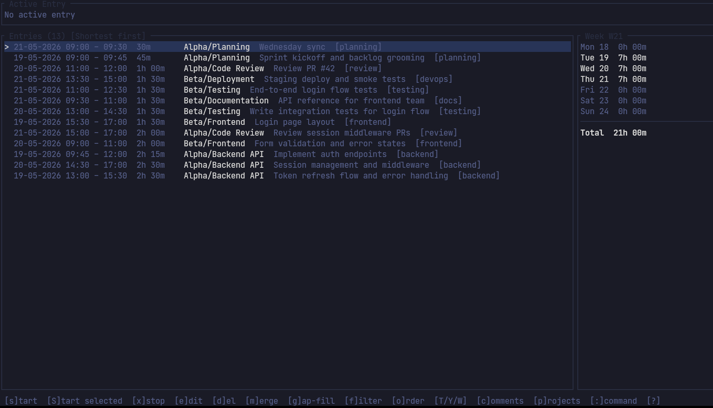

# tmkpr — Rust Time Tracking Suite

A comprehensive, fast, and offline time tracker written in Rust. Track time against projects and tasks with a focus on simplicity and cross-platform compatibility. All data is stored locally in SQLite, giving you full control over your time-tracking information.



📖 **[Full user manual](https://ljantzen.github.io/timekeeper/)** — installation, configuration, and the complete command/keybinding reference for all three tools.

## Features

- **Project & Task Management**: Organize your work with projects and flexible task hierarchies
- **Time Entry Logging**: Track work with start/stop timers or manually log entries
- **Entry Editing**: Modify any time entry retroactively with natural language time input
- **Reporting**: View summaries by project, daily reports, weekly breakdowns, and ISO week reports
- **Comments**: Attach free-form notes to any entry for context
- **Tagging**: Organize entries with custom tags
- **Data Portability**: Import and export entries in CSV or JSON format
- **Obsidian Integration**: Automatically log activities, comments, and project/task changes to your Obsidian vault (optional)
- **Fast & Responsive**: Built in Rust for speed and reliability
- **Offline-First**: Works completely offline, syncs to local SQLite database
- **No Cloud Required**: Your time data stays on your machine

## Interfaces

Choose the interface that best fits your workflow:

### **[tmkpr-cli](tmkpr-cli/README.md)** — Command-line tool

Full-featured CLI for time tracking. Perfect for integration with scripts, cron jobs, and text-based workflows.

**Highlights:**
- Complete command coverage for all operations
- Natural language time input ("2 hours ago", "yesterday 9am")
- Multiple output formats (table, JSON, CSV, Markdown)
- Shell completion (Bash, Zsh, Fish)
- Context-aware task handoff without time gaps
- Scripting-friendly with structured output

**Quick example:**
```bash
tmkpr project add myproject
tmkpr task add coding -p myproject
tmkpr start -p myproject -t coding -n "feature development"
tmkpr stop
tmkpr report --wweek
```

### **[tmkpr-ui](tmkpr-ui/README.md)** — Terminal dashboard

Full-featured terminal UI dashboard built with [ratatui](https://github.com/ratatui/ratatui). Great for interactive session management and real-time visibility.

**Highlights:**
- Live timer display for active entries
- Sortable/filterable entry list
- Week report sidebar
- Project and task management
- Entry editing and deletion
- Intuitive vim-style keybindings
- Quick forms with autocomplete
- Command mode (`:`) for themes, settings, and config management
- 23 built-in colour themes with live preview

**Launch:**
```bash
tmkpr-ui
tmkpr ui      # via the CLI
```

### **[tmkpr-pomodoro](tmkpr-pomodoro/README.md)** — Pomodoro timer

Integrated Pomodoro timer that automatically logs sessions to the database. Ideal for focused work sessions with built-in breaks.

**Highlights:**
- 25-minute work sessions with 5-minute breaks (configurable)
- Automatic long breaks after N sessions
- Project and task selection from database
- Audio and desktop notifications
- Pause/resume capability
- Configurable cycle settings
- In-app settings editor

**Launch:**
```bash
tmkpr-pomodoro
tmkpr pomodoro   # via the CLI
```

## Installation

Download the latest binary for your OS from the [Github Releases](https://github.com/ljantzen/timekeeper/releases) page, or install from source:

```bash
cargo install --path tmkpr-cli
cargo install --path tmkpr-ui
cargo install --path tmkpr-pomodoro --features audio
```

See the [manual's Installation chapter](https://ljantzen.github.io/timekeeper/installation.html) for building without audio support, per-tool build commands, and the project's crate structure.

## Configuration

Config lives at `~/.config/tmkpr/config.toml`, data in `~/.local/share/tmkpr/tmkpr.db`. See the [manual's Configuration chapter](https://ljantzen.github.io/timekeeper/configuration.html) for the full `config.toml` reference, overriding the database/theme via flags or environment variables, built-in and custom colour themes, and optional Obsidian vault logging.

## Quick Start

See the [manual's Quick Start chapter](https://ljantzen.github.io/timekeeper/quick-start.html) for a walkthrough of creating a project, tracking time, and viewing reports across all three tools.

## Architecture

See [ARCHITECTURE.md](ARCHITECTURE.md) for detailed documentation on the tmkpr-ui codebase, maintainability guide, and refactoring roadmap.

## Contributing

See [CONTRIBUTING.md](CONTRIBUTING.md) for guidelines on contributing to this project.

## License

MIT
